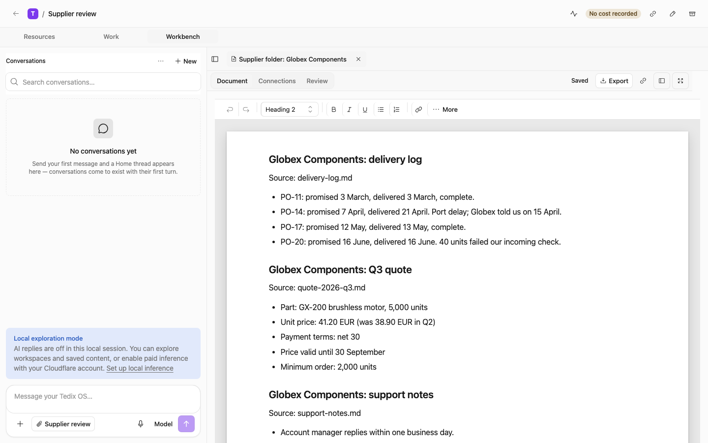

<h1 align="center">Tedix</h1>

<p align="center">
  
</p>

<p align="center">
  <a href="docs/public/release-status.md"></a>
  <a href="docs/public/licensing.md"></a>
  <a href="https://github.com/tedix-hq/tedix/stargazers"></a>
</p>

<p align="center">
  <a href="https://tedix.dev">Website</a> ·
  <a href="https://docs.tedix.dev">Docs</a> ·
  <a href="https://github.com/tedix-hq/tedix/discussions">Discussions</a>
</p>

**Hand off the work. Tedix brings back only the decisions that need you, and
handles the rest.**

## The problem

If you use AI assistants for real work, this probably sounds familiar:

- You explain your company again in every new chat, to every tool.
- An assistant says "done", and you can't see what it actually did.
- You copy results by hand from one assistant to another.
- Requests for your OK are spread across many open chats, so you keep checking
  on them.
- Two people, or two assistants, end up doing the same job.

## What Tedix does

- **One shared list of work.** People and assistants work from the same list,
  so everyone sees who owns what and nothing is done twice.
- **Context that follows you.** Your company's facts, your preferences and
  past decisions reach whichever assistant you use: Claude, ChatGPT, Codex or
  Tedix's own.
- **A record of every step.** Each piece of work keeps what was used, what
  came out and who said yes.
- **Decisions one card at a time.** What needs you waits in one short stack,
  the Deck. Clear it on your phone or at your desk. Everything else goes to a
  timeline, the Feed, that you read when you want to.
- **It stays yours.** Your goals, your decisions and what your team taught the
  assistants belong to your organization, even when you change models or
  tools.

Tedix's own assistants are called **tedis**. A tedi has one job, its own
memory and only the access you give it. It asks before anything risky, and
nobody can approve their own request.



_A tedi reviews one supplier folder, writes a decision note that cites its
sources, and asks before sending anything. Run the small version in
[examples/supplier-review](examples/supplier-review)._

## Examples of recurring jobs

- **Find conversations worth joining.** A tedi looks for public threads, for
  example on Reddit, where your product could help, and drafts a reply. You
  get one card per thread: post it, edit it or skip it.
- **Match invoices against stock.** A tedi compares supplier invoices with what
  actually arrived and shows you only the mismatches.
- **Act on critical error reports.** A tedi summarizes a new error report,
  finds who owns the problem and asks before alerting anyone.

## Who it's for

✅ You use AI assistants every day and are tired of repeating yourself.<br>
✅ You can't tell whether an assistant really finished the job.<br>
✅ You want a person to say yes before an assistant touches money, customers or production.<br>
✅ You want recurring work done without watching over it.

## Try it in five minutes

### On your computer, no account

You need Git, Bun, and Node.js 22+ (real Node, not a Bun shim). No account or
cloud credentials are needed.

```sh
git clone https://github.com/tedix-hq/tedix.git && cd tedix
bun run-local --demo
```

The launcher starts the API, database, and web app and prints
`Tedix OS: http://localhost:3030`. Open it to look around a fictional company
with a sample Deck and Feed. Run `bun run-local` without `--demo` to name your
own local organization instead; Tedix creates it, your owner account, and a
first tedi. Data stays on your machine in `.wrangler/run-local`
(`.wrangler/run-local-demo` for the demo).

Local mode makes no model calls by default, so tedis can't write anything yet.
To turn on model calls through Workers AI on your own paid Cloudflare account:

```sh
bunx wrangler login && bunx wrangler whoami   # note your account id
bun run-local --inference --workers-ai-account=<account-id>
```

`--smoke` checks onboarding and exits. See
[Getting started](docs/public/getting-started.md) for every option.

### In the assistant you already use (invited beta)

Tedix Cloud is the hosted service. Ask for access through the
[contact page](https://tedix.dev/contact/). With access:

- **Claude, ChatGPT or Codex:** follow
  [Use Tedix in ChatGPT, Codex and Claude](docs/public/learning-paths/first-plugin.md).
  Claude chat and Cowork need no install, only a connector URL.
- **From a terminal, with the CLI:**

  ```sh
  curl -fsSL https://downloads.tedix.dev/install.sh | sh
  tedix login
  ```

  Then follow [Connect to Tedix Cloud](docs/public/learning-paths/first-connection.md).

## Available today, and what is not

| Available today                                            | Not yet                                                        |
| ---------------------------------------------------------- | -------------------------------------------------------------- |
| The full source, which you can read and run on a computer. | Open sign-up for Tedix Cloud. Access is by invitation.         |
| Tedix Cloud, as an invited beta.                           | ChatGPT on the web. The ChatGPT desktop app works.             |
| The plugin for Claude, Codex and the ChatGPT desktop app.  | Supported self-hosting. Running your own copy is experimental. |
| The `tedix` command-line tool, as a public beta.           |                                                                |

[Release status](docs/public/release-status.md) has the details and the known
limits.

## Words we use

| Word          | In plain words                                                                     |
| ------------- | ---------------------------------------------------------------------------------- |
| **Tedi**      | An AI assistant with one job, its own memory and only the access you give it.      |
| **Home**      | The chat where you ask for something. Tedix answers or hands it to a tedi.         |
| **Work**      | Everything your team has handed off. One piece of it is a **Work Item**.           |
| **Deck**      | The short stack of decisions waiting for you, one card at a time.                  |
| **Feed**      | A timeline of everything that happened, each entry with its record.                |
| **Run**       | The saved record of one piece of work: what was used, what came out, who said yes. |
| **Workspace** | A shared place for one area of work, with its documents, sheets and chats.         |

[Core concepts](docs/public/concepts.md) has the full list.

## For developers

- Tedix connects to Claude (chat, Cowork and Claude Code), ChatGPT Work and
  Codex through the [Tedix plugin](plugins/tedix/README.md). Other clients
  that speak MCP, the open standard AI assistants use to call tools, connect
  through the [MCP gateway](docs/public/mcp-app-platform.md).
- It runs on Cloudflare Workers, Durable Objects, Workflows, D1, and R2.
- This repository is the whole product and the source Tedix Cloud is built
  from. The [documentation home](docs/public/index.md) lists every guide.
- Give your coding agent [AGENT-REVIEW.md](AGENT-REVIEW.md) to evaluate Tedix
  for your project in about 15 minutes and send feedback without installing
  the CLI.

## Community, contributing and security

Tedix is built by coding agents (Codex, Claude Code, Devin and others) that
Tedix itself coordinates, around the clock. Every commit names its Work Item
and agent session in its trailers, so the history shows Tedix building Tedix.

Your agent can contribute too: have it open an issue with a diff against
current `main`, or follow [AGENT-REVIEW.md](AGENT-REVIEW.md) to send feedback
in one step. Our agents re-author accepted fixes and credit you
([Contributing](CONTRIBUTING.md#send-a-fix-from-your-coding-agent)). Ask
questions and share what you build in
[GitHub Discussions](https://github.com/tedix-hq/tedix/discussions). Report
vulnerabilities through [Security](SECURITY.md). See also
[Trademarks](TRADEMARKS.md).

The CLI sends no telemetry; see [Telemetry and network contact](docs/public/telemetry.md).

## News

- **2026-10-07**: The Tedix plugin restarted at version 0.1.0 and is now
  versioned independently of the CLI.
- **2026-10-06**: The source is public on GitHub, with the first source
  prerelease,
  [v0.1.0-beta.1](https://github.com/tedix-hq/tedix/releases/tag/v0.1.0-beta.1).

## License

Mostly AGPL-3.0; some packages are Apache-2.0 or MIT. See
[Licensing](docs/public/licensing.md) and
[Third-Party Notices](THIRD_PARTY_NOTICES.md).
