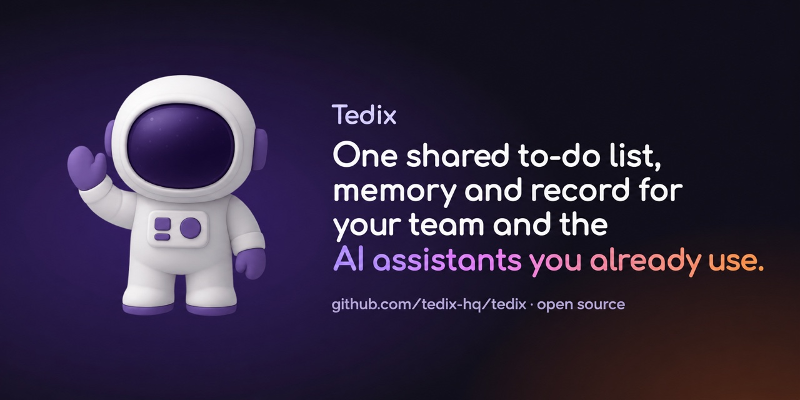
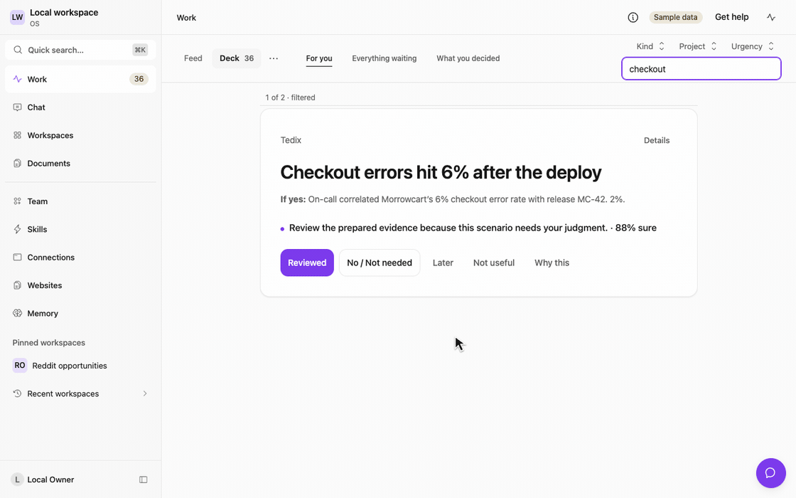

<h1 align="center">Tedix</h1>

<p align="center">
  
</p>

<p align="center">
  <a href="docs/public/release-status.md"></a>
  <a href="docs/public/licensing.md"></a>
  <a href="https://github.com/tedix-hq/tedix/stargazers"></a>
  <a href="https://deepwiki.com/tedix-hq/tedix"></a>
</p>

<p align="center">
  <a href="https://tedix.dev">Website</a> ·
  <a href="https://docs.tedix.dev">Docs</a> ·
  <a href="https://github.com/tedix-hq/tedix/discussions">Discussions</a>
</p>

**A platform for agents, apps, and work.**

## What is Tedix?

Tedix is a shared place for your team and AI agents to get work done.
It brings together the information they need, the apps they use, and a record
of what happened.

You can ask for research, prepare a document, review invoices, or set up a job
that runs every week. Your team can pick up the result, see how it was made,
and decide what happens next.

It is easy for people and AI agents to lose shared context and coordination
when work is split across many tools, chats, and projects.

## Why do I need Tedix?

Using AI at work often means repeating the same instructions, moving answers
between chats, and checking whether something was actually done.

Tedix gives that work a shared home:

- **Explain things once.** Save your team's facts, instructions, and decisions
  for assistants to use in later tasks.
- **See who is doing what.** People and agents share a list of tasks, with an
  owner, progress, and results for each one.
- **Keep the result useful.** Put documents, spreadsheets, and apps together
  in a workspace where your team can find them.
- **Know when you are needed.** Review requests for your approval in one place
  and check other updates when it suits you.

Tedix is meant to build trust so people can work alongside agents and see
what needs attention.

If a quick chat already does everything you need, you may not need Tedix.
It becomes useful when work involves other people, multiple projects, several
tools, or a task you want to do again.

## How does it work?

1. **Start by creating your organization.** Bring your agents, such as Claude,
   ChatGPT, or Codex, and invite your human team members into your shared workspace.
2. **Describe your projects.** Add relevant information and enable the apps
   your project needs. You choose what it can access and which actions need approval.
3. **Coordinate tasks between people and agents.** An agent or human can
   research, write, use connected tools, or help build an app. A workspace keeps
   related chats, files, and apps together. Quickly onboard new team members,
   agents, or tools.
4. **Review the result.** See the output and the saved record of the task.
   Decisions waiting for you are clearly visible; other updates appear in
   an overview.

For example, you could ask: “Review this supplier's documents before our next
order.” An assistant reads the files you provide, writes a note with links
to its sources, and points out what needs your attention. You review the note
before deciding what to do.



_Tedix OS: read the evidence, confirm a review,
and leave another decision for later._

## What problems does Tedix solve?

| Problems                                                                                  | Solutions                                                                                                                                    |
| ----------------------------------------------------------------------------------------- | -------------------------------------------------------------------------------------------------------------------------------------------- |
| Agents lack context when moving between tools, or people keep explaining the same things. | Keep project and company information available to the agents, and connect them to the tools they need under the organization's access rules. |
| It is hard to tell what an agent did or what information it used.                         | Keep a record of its actions, tools, approvals, and results so people can review what happened.                                              |
| Several agents or chats cause duplicate work and manual copy-and-paste handoffs.          | Give people and agents shared project context, task lists, owners, and a backlog.                                                            |
| Technical and non-technical work is split between different systems.                      | Bring project work and its context together so people and agents can follow it in one place.                                                 |
| People cannot continue work when they are away from their usual computer or terminal.     | Let them reach project context and agent tools through supported chat or assistant interfaces.                                               |
| New agents need repeated explanations about the company and how a person prefers to work. | Keep company knowledge and working instructions available for agents to reuse.                                                               |
| People spend time responding to routine agent questions and approvals.                    | Help surface requests that need attention, and handle routine steps only within rules the organization has set.                              |
| Teams with several people and agents need to avoid overlap and track priorities.          | Use shared tasks and project views to show what is assigned, in progress, and completed.                                                     |

Tedix connects agents, company tools, project context, and shared tasks so
people and AI agents can work together and people can see the latest change.

## Who is this for?

- **Developers who use AI at work** and want to spend less time repeating
  instructions and chasing results.
- **Teams with recurring jobs**, such as reviewing code changes, preparing
  reports, or drafting replies for someone to check.
- **Organizations that need to standardize guidelines** across development
  environments and shared work.
- **Developers building agents and apps** that need to work with a team's
  information, tools, and permissions.

## What stays under your control?

You choose which tools an assistant may use and what needs someone's approval.
Your team's saved information and work history stay with your organization
when you change agents or models.

AI can still make mistakes. A task marked complete records what the assistant
reported; it does not prove that the answer is right or an outside action
succeeded. See the [known limits](docs/public/release-status.md#known-limits).

## How do I start?

### Use Tedix Cloud

Tedix Cloud is the hosted service, currently available by invitation.
[Request access](https://tedix.dev/contact/), then follow
[Use Tedix in ChatGPT, Codex and Claude](docs/public/learning-paths/first-plugin.md).
Any coding agent that reads Agent Skills can add the plugin's skills with
`npx skills add tedix-hq/tedix-plugins`.

The plugin and command-line tool are public betas. ChatGPT support currently
requires the desktop app. [Release status](docs/public/release-status.md)
lists what is available and what is still experimental.

### Try it on your computer

The source is public, and the local demo needs no account. You need Git, Bun,
and Node.js 22.23.4+, 24.22+, or 26.12+ within those majors (real Node,
not a Bun shim).

```sh
git clone https://github.com/tedix-hq/tedix.git
cd tedix
bun run-local --demo
```

Open the address printed as `Tedix OS`, normally `http://localhost:3030`.
The demo lets you explore a fictional company with sample tasks and decisions.
Data stays on your computer. AI replies are off by default; the
[local setup guide](docs/public/getting-started.md) explains how to turn them on
using your own paid Cloudflare account.

Running Tedix in your own cloud account is experimental. See the
[self-hosting guide](docs/public/self-hosted-boundary.md) before trying it.

## Where can I learn more?

- [Documentation](docs/public/index.md): guides for using and building Tedix.
- [Core concepts](docs/public/concepts.md): names you will see in the product.
- [CLI](docs/public/cli.md): use Tedix from a terminal.
- [Connect apps and tools](docs/public/mcp-app-platform.md): developer guide
  to connecting assistants and services through MCP.
- [Architecture](docs/public/cloudflare-architecture.md): how Tedix runs on Cloudflare.
- [AGENTS.md](AGENTS.md): instructions for coding agents working in this repository.

## Contribute or get help

Tedix is built by coding agents coordinated through Tedix itself. Each
maintainer commit identifies its task and agent session.

To contribute, follow [Contributing](CONTRIBUTING.md). Report vulnerabilities
through [Security](SECURITY.md).

Tell us what worked and what did not:

- **People:** ask questions and share ideas or experiences in
  [GitHub Discussions](https://github.com/tedix-hq/tedix/discussions), or file
  a bug report or feature request from the issue templates.
- **Agents:** give your coding agent [AGENT-REVIEW.md](AGENT-REVIEW.md). It
  reviews Tedix for your project and sends a private report with a fit score,
  blockers, suggestions and bugs.

The CLI sends no telemetry, so this feedback is how we learn whether Tedix
helps. See [how we measure adoption](docs/public/telemetry.md#how-we-measure-adoption-without-telemetry).

## License

Mostly AGPL-3.0; some packages are Apache-2.0 or MIT. See
[Licensing](docs/public/licensing.md), [Third-Party Notices](THIRD_PARTY_NOTICES.md),
and [Trademarks](TRADEMARKS.md).
